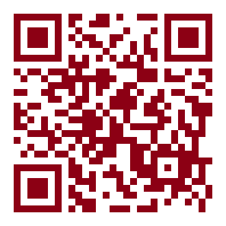

```{r}
#| label: setup
#| include: false
# Solution slides run the real code. Both data sets ship with R packages, so no files are needed.
library("ggsci")
library("ggthemes")
library("psychTools")
library("psymetadata")
library("tidyverse")
library("patchwork")
library("scales")
knitr::opts_knit$set(root.dir = "../notebooksanddata")
options(width = 50, tibble.print_min = 4, tibble.print_max = 4, pillar.max_extra_cols = 4)

# Larger text on the projector: the solutions' theme_minimal() at base size 14.
theme_minimal <- function(base_size = 14, ...) ggplot2::theme_minimal(base_size = base_size, ...)
theme_slide <- function() {
  theme_minimal(base_size = 15) +
    theme(panel.grid.minor = element_blank(), legend.position = "bottom")
}
red <- "#E2001A"; dark <- "#8C0014"; pink <- "#F28A94"; grey <- "#6B6B6B"; navy <- "#1F4E79"; green <- "#1D7A46"
okabe <- c(orange = "#E69F00", blue = "#0072B2")
f2 <- function(x) sprintf("%.2f", x)
big <- function(x) format(x, big.mark = ",")
```

```{r}
#| label: data
#| include: false
# Everything below follows my202-02-lab-completed.qmd
hs_data <- holzinger.swineford |> as_tibble()
n_hs <- nrow(hs_data)
n_school <- count(hs_data, school) |> deframe()
n_tests <- sum(str_detect(names(hs_data), "^t\\d"))
cubes_5_7 <- mean(hs_data$t02_cubes >= 5 & hs_data$t02_cubes <= 7)
r_vis <- cor(hs_data$t01_visperc, hs_data$t03_frmbord)
n_spots <- nrow(distinct(hs_data, t01_visperc, t03_frmbord))
med_g <- hs_data |> group_by(grade) |> summarise(m = median(t16_figrrecg)) |> deframe()
mean_s <- hs_data |> group_by(female) |> summarise(m = mean(t23_series)) |> deframe()

nu <- as_tibble(nuijten2020)
n_es <- nrow(nu)
n_studies <- n_distinct(nu$study_id)
by_year <- nu |> count(year)
peak_year <- by_year |> slice_max(n) |> pull(year)
peak_n <- max(by_year$n)
```

```{r}
#| label: visuals
#| include: false
# ---- Concept visuals. Helpers draw a plot up to step k; a slide stacks one version per step.

# Six questions, six charts: thumbnails of the lab's exercises
thumb <- function(p, title, sub) {
  p + theme_void(base_size = 12) +
    theme(plot.title = element_text(face = "bold", colour = dark, size = 14),
          plot.subtitle = element_text(colour = grey, size = 11, margin = margin(b = 6)),
          plot.margin = margin(6, 10, 6, 10),
          legend.position = "none") +
    labs(title = title, subtitle = sub)
}
thumbs <- list(
  thumb(ggplot(hs_data, aes(t02_cubes)) + geom_histogram(bins = 20, fill = "#BDBDBD", colour = "white"),
        "2.1 Histogram", "How is one number spread out?"),
  thumb(ggplot(count(hs_data, school), aes(n, school)) + geom_col(fill = red, width = 0.6),
        "2.2 Bar chart", "How many in each group?"),
  thumb(ggplot(hs_data, aes(t01_visperc, t03_frmbord, colour = school)) + geom_jitter(size = 1, alpha = 0.6) +
          scale_colour_manual(values = c(red, navy)),
        "2.3 Scatter plot", "Do two numbers move together?"),
  thumb(ggplot(by_year, aes(year, n)) + geom_line(colour = navy, linewidth = 0.8),
        "2.4 Line plot", "How does it change over time?"),
  thumb(ggplot(hs_data, aes(factor(grade), t16_figrrecg)) + geom_boxplot(fill = pink, outlier.size = 0.8),
        "2.5 Box plot", "How do groups compare: middle and spread?"),
  thumb(ggplot(mutate(hs_data, g = factor(female)), aes(t23_series, fill = g)) + geom_density(alpha = 0.4, colour = NA) +
          scale_fill_manual(values = c(navy, red)),
        "2.6 Density plot", "How do groups compare: the whole shape?")
)

# A layer at a time, for the grammar slide
base_scatter <- hs_data |> ggplot(aes(t08_wordclas, t09_wordmean))

# Four looks for the same plot
look <- function(p, title) p + labs(title = title, x = "t08_wordclas", y = "t09_wordmean") +
  theme(plot.title = element_text(face = "bold", size = 13))
looks <- list(
  look(base_scatter + geom_point(size = 1) + ggplot2::theme_grey(base_size = 11), "default"),
  look(base_scatter + geom_point(size = 1) + ggplot2::theme(panel.grid = element_blank(), axis.ticks = element_blank(),
                                                           panel.background = element_rect(fill = "transparent"),
                                                           text = element_text(size = 11)), "my_theme()"),
  look(base_scatter + geom_point(size = 1) + ggplot2::theme_minimal(base_size = 11), "theme_minimal()"),
  look(base_scatter + geom_point(size = 1) + ggthemes::theme_clean(base_size = 11), "theme_clean()")
)

# Bins are a design choice
bins_plot <- function(b) {
  ggplot(hs_data, aes(t02_cubes)) +
    geom_histogram(bins = b, fill = "#BDBDBD", colour = "white") +
    theme_slide() + theme(panel.grid.major.x = element_blank(), plot.title = element_text(face = "bold", size = 15)) +
    labs(x = "Cube test score", y = NULL, title = paste(b, "bins"))
}

# Overplotting: geom_point() hides students that geom_jitter() shows
over_plot <- function(jit) {
  geom <- if (jit) geom_jitter(alpha = 0.5, size = 2, colour = navy, position = position_jitter(width = 0.1, height = 0.15, seed = 1))
          else geom_point(alpha = 0.5, size = 2, colour = navy)
  ggplot(hs_data, aes(t01_visperc, t03_frmbord)) + geom +
    theme_slide() + theme(plot.title = element_text(face = "bold", size = 15)) +
    labs(x = "Visual perception", y = "Form board",
         title = if (jit) "geom_jitter(): nudged a little" else "geom_point(): stacked on top of each other")
}

# What is one row? Effect sizes against studies, by year
rows_plot <- function() {
  bind_rows(
    nu |> count(year) |> mutate(what = "rows: effect sizes (what count(year) counts)"),
    nu |> distinct(study_id, year) |> count(year) |> mutate(what = "distinct studies")
  ) |>
    ggplot(aes(year, n, colour = what)) +
    annotate("rect", xmin = 2008.5, xmax = 2013.5, ymin = -Inf, ymax = Inf, fill = red, alpha = 0.08) +
    annotate("text", x = 2008, y = 18, hjust = 1, label = "after 2008: not\nyet in the reviews", colour = red,
             fontface = "bold", size = 3.8, lineheight = 0.9) +
    geom_line(aes(linetype = what), linewidth = 1) +
    scale_colour_manual(values = c(grey, navy), name = NULL) +
    scale_linetype_manual(values = c("dashed", "solid"), name = NULL) +
    coord_cartesian(xlim = c(1960, 2013)) +
    theme_slide() + theme(legend.direction = "vertical") +
    labs(x = "Year the primary study came out", y = "Count")
}

# Reading a box plot, step by step, on the grade 8 figure recognition scores
g8 <- hs_data |> filter(grade == 8)
q8 <- quantile(g8$t16_figrrecg, c(0.25, 0.5, 0.75))
iqr8 <- q8[[3]] - q8[[1]]
lo8 <- min(g8$t16_figrrecg[g8$t16_figrrecg >= q8[[1]] - 1.5 * iqr8])
hi8 <- max(g8$t16_figrrecg[g8$t16_figrrecg <= q8[[3]] + 1.5 * iqr8])
box_step <- function(k) {
  p <- ggplot(g8, aes(x = 1, y = t16_figrrecg)) +
    coord_cartesian(xlim = c(0.4, 2.6), ylim = c(2.5, 9.3)) +
    theme_slide() +
    theme(axis.text.x = element_blank(), panel.grid.major.x = element_blank()) +
    labs(x = "Grade 8", y = "Figure recognition score")
  if (k >= 2) p <- p + geom_boxplot(width = 0.5, fill = pink, alpha = 0.6, colour = dark, outlier.shape = NA)
  p <- p + geom_jitter(alpha = if (k >= 2) 0.25 else 0.6, colour = grey, size = 1.8, position = position_jitter(width = 0.12, height = 0, seed = 2))
  if (k >= 3) {
    lab <- function(y, text, col = dark) annotate("text", x = 1.4, y = y, hjust = 0, label = text, colour = col,
                                                    fontface = "bold", size = 4.3)
    p <- p +
      lab(q8[[2]], paste0("median ", sprintf("%.2f", q8[[2]]), ": half above, half below")) +
      lab(q8[[3]] + 0.15, "75% of students below this line") +
      lab(q8[[1]] - 0.15, "25% below this line") +
      lab(hi8, "whisker: the furthest point\nwithin 1.5 boxes", col = grey) +
      lab(3.4, "outliers: further out,\ndrawn one by one", col = grey)
  }
  p
}

# Accessibility: a red/green palette, as seen with deuteranopia, and a fix
cb_plot <- function(cols, shapes = FALSE, title) {
  p <- ggplot(hs_data, aes(t01_visperc, t03_frmbord, colour = school))
  p <- if (shapes) p + geom_jitter(aes(shape = school), size = 2.2, alpha = 0.8, position = position_jitter(seed = 1))
       else p + geom_jitter(size = 2.2, alpha = 0.8, position = position_jitter(seed = 1))
  p + scale_colour_manual(values = unname(cols), name = NULL) +
    scale_shape_manual(values = c(16, 17), name = NULL) +
    theme_slide() +
    theme(plot.title = element_text(face = "bold", size = 14), axis.title = element_text(size = 12)) +
    labs(x = "Visual perception", y = "Form board", title = title)
}
rg <- c(red, green)

# Makeover: before and after
makeover_before <- function() {
  hs_data |>
    ggplot(aes(as.factor(grade), t16_figrrecg)) +
    geom_boxplot() +
    ggplot2::theme_grey(base_size = 13)
}
makeover_after <- function() {
  hs_data |>
    ggplot(aes(as.factor(grade), t16_figrrecg)) +
    geom_boxplot(fill = c("#D9D9D9", pink), colour = c(grey, dark), width = 0.5) +
    theme_slide() + theme(panel.grid = element_blank(), plot.title = element_text(face = "bold", size = 15),
                          plot.title.position = "plot") +
    labs(x = "Grade", y = "Figure recognition score",
         title = "Grade 8 scores a little higher than grade 7")
}
```

## Lab overview

::: {.small-table}
| Part | Topic | Functions | Mode | Time |
|---|---|---|---|---|
| | Setup, two warm-up questions, meet the data | `library()`, `as_tibble()` | together | 8 min |
| 2.0 | How a ggplot is built, and themes | `ggplot()`, `aes()`, `geom_point()`, `theme()` | together | 14 min |
| 2.1–2.2 | Distributions and counts | `geom_histogram()`, `count()`, `geom_col()` | your turn | 15 min |
| 2.3–2.4 | Relationships and time | `geom_jitter()`, `scale_colour_*()`, `geom_line()` | your turn | 18 min |
| 2.5–2.6 | Comparing groups | `geom_boxplot()`, `geom_density()`, `if_else()` | concept, then your turn | 16 min |
| | Design principles, peer critique, wrap-up | | together · pairs | 14 min |
:::

::: {.source-note}
**Together**: we type the code into the notebook, the slide explains each piece, and the line number says where. **Your turn**: a timer, tasks and an annotated syntax sheet, then the solutions step by step.
:::

::: {.notes}
Timing (90 minutes): setup, warm-up and data 8, Part 2.0 14, round 1 15, round 2 18, round 3 16, design principles and peer critique 9, wrap-up 5; about 5 minutes spare. Checkpoints: Part 2.0 by 0:08, round 1 by 0:22, round 2 by 0:37, round 3 by 0:55, design by 1:11, wrap-up by 1:20. If behind, skip in this order: warm-up 1 (1 min), the "Four looks" slide (say it in one sentence, 1 min), shorten the round 3 timer from 9 to 7, then take the makeover slide at speed.

How the split was decided: everything in 2.0 is shown in the notebook already, so we run it together and take it apart. The six design exercises have empty chunks (`# Code here`), so they are your turn, three rounds of two, each with a syntax sheet and a step-by-step solution. Concepts that the notebook doesn't explain but the solutions rely on (bins, jitter, what one row is, reading a box plot, `as.factor()`) get their own slide next to the exercise.

- Last week you summarised and reshaped data. Today you draw it. ggplot is the plotting part of the tidyverse, and today is the first time we use it properly.
- The notebook's three-part recipe for every plot: a theme, the skeleton plot, and an annotation: a caption that says what the plot shows.
- Open the Week 2 student notebook on Nuvolos and run the library chunk (lines 16–23) and the `hs_data` chunk (lines 29–36) now.
:::

# Visualisation {.divider background-color="#8C0014"}

::: {.kicker}
Warm-up
:::

Two questions · choosing a chart · saying what it shows

## Warm-up 1 of 2

```{=html}
<div class="tracker"><span class="on">Warm-up</span><span>1 · Setup</span><span>2.0 · ggplot</span><span>2.1–2.2</span><span>2.3–2.4</span><span>2.5–2.6</span><span>Design</span><span>Wrap-up</span></div>
```

::: {.ask}
You have one test score for each of 300 students. You want to show **how the scores are spread out**: are most in the middle, are there a few very low ones? Which chart?
:::

```{=html}
<div class="mcq">
  <div class="opt"><b>A</b>A bar chart with one bar per student</div>
  <div class="opt right"><b>B</b>A histogram: bars that count how many students fall in each score range</div>
  <div class="opt"><b>C</b>A line plot of the scores in the order of the data</div>
  <div class="opt"><b>D</b>A pie chart</div>
  <div class="fragment why"><b>B.</b> A histogram groups the scores into ranges (bins) and counts each. 300 bars (A) is unreadable, and the order of the rows (C) means nothing. That's exercise 2.1.</div>
</div>
```

::: {.notes}
Timing: two questions, one minute each. Hands up for each option, then click to reveal.

- Gauge: whether students already know the basic chart types. If many pick A or C, spend an extra minute on "Which chart for which question?".
:::

## Warm-up 2 of 2

```{=html}
<div class="tracker"><span class="on">Warm-up</span><span>1 · Setup</span><span>2.0 · ggplot</span><span>2.1–2.2</span><span>2.3–2.4</span><span>2.5–2.6</span><span>Design</span><span>Wrap-up</span></div>
```

::: {.ask}
Two captions for the same histogram. Which one helps a reader more?
:::

```{=html}
<div class="mcq">
  <div class="opt"><b>A</b>“Figure 1: Histogram of t02_cubes.”</div>
  <div class="opt right"><b>B</b>“Figure 1: Most students score between 5 and 7 on the cubes test.”</div>
  <div class="opt"><b>C</b>No caption: the plot speaks for itself</div>
  <div class="fragment why"><b>B.</b> A says what the plot <em>is</em>; the reader can see that. B says what it <em>shows</em>. Every exercise today ends with a caption like B: the notebook's <code>ANNOTATION HERE</code>.</div>
</div>
```

::: {.notes}
- Plant the idea now: the caption is the finding, in one sentence. The completed notebook's captions all follow that pattern ("There are (slightly) more students from Pasteur than from Grant-White").
- C is a common instinct. Plots rarely speak for themselves; a caption tells the reader where to look.
:::

# Setup {.divider background-color="#8C0014"}

::: {.kicker}
Part 1
:::

Five packages · `r n_hs` school children · `r n_tests` mental ability tests

## Setup

```{=html}
<div class="tracker"><span class="done">Warm-up</span><span class="on">1 · Setup</span><span>2.0 · ggplot</span><span>2.1–2.2</span><span>2.3–2.4</span><span>2.5–2.6</span><span>Design</span><span>Wrap-up</span></div>
```

```{=html}
<p class="nbref"><b>Notebook</b> lines 16–36 <span>the library chunk, then <code>hs_data</code></span><i>run together</i></p>
```

:::: {.columns}

::: {.column width="52%"}
```r
library("ggsci")       # colour palettes
library("ggthemes")    # more ready-made themes
library("psychTools")  # the Holzinger-Swineford data
library("psymetadata") # the Nuijten (2020) data
library("tidyverse")   # dplyr, ggplot2 and friends

hs_data <-
  holzinger.swineford |>
  as_tibble()

hs_data
```
:::

::: {.column width="48%"}
::: {.card .compact}
[No data files today]{.ct}
Both data sets come inside R packages. Loading the package is enough; `as_tibble()` makes it print nicely, as in Lab 1.
:::

::: {.card .compact .line}
[What's in it?]{.ct}
`?holzinger.swineford` in the console opens the help page with every column (line 38).
:::

::: {.card .compact}
[`ggplot2` is already loaded]{.ct}
It's one of the packages inside `tidyverse`.
:::
:::

::::

::: {.notes}
- Run both chunks now. If a package is missing, hands up straight away. `ggthemes` and `psychTools` are new this week; Nuvolos should have them.
- `holzinger.swineford` is a plain data frame; `as_tibble()` only changes how it prints.
:::

## Meet the data

```{=html}
<div class="tracker"><span class="done">Warm-up</span><span class="on">1 · Setup</span><span>2.0 · ggplot</span><span>2.1–2.2</span><span>2.3–2.4</span><span>2.5–2.6</span><span>Design</span><span>Wrap-up</span></div>
```

```{=html}
<div class="bignums">
  <div><b>`r n_hs`</b><span>children in grades 7 and 8 at two US schools, tested in the late 1930s. One row each.</span></div>
  <div><b>`r n_tests`</b><span>mental ability tests, <code>t01_visperc</code> to <code>t26_flags</code>: spatial, verbal, speed, memory, reasoning</span></div>
  <div><b>`r big(n_es)`</b><span>rows in the second data set, <code>nuijten2020</code>: results from 131 reviews of intelligence research. Used in 2.4.</span></div>
</div>
```

::: {.cards .c3 style="margin-top:0.5em"}
::: {.card .compact}
[Who they are]{.ct}
`school` (Pasteur `r n_school[["Pasteur"]]`, Grant-White `r n_school[["Grant-White"]]`) · `grade` (7 or 8) · `female` · `ageyr`
:::
::: {.card .compact}
[Tests used today]{.ct}
`t01_visperc` visual perception · `t02_cubes` · `t03_frmbord` form board · `t08_wordclas` · `t09_wordmean` · `t16_figrrecg` figure recognition · `t23_series`
:::
::: {.card .compact .dark}
[Watch the coding]{.ct}
`female` is 1 for **male** and 2 for **female**, not 0/1. `grade` is stored as a number. Both matter in 2.5 and 2.6.
:::
:::

::: {.notes}
Timing: setup and this slide together 3 minutes.

- A classic psychometrics data set (Holzinger and Swineford, 1939). Each test score is on its own scale; higher is better.
- The coding of `female` (1 = male, 2 = female) is from the help page. The solutions get it right in 2.6; flag it now so nobody writes `female == 1` for girls.
:::

# How a ggplot is built {.divider background-color="#8C0014"}

::: {.kicker}
Part 2.0
:::

Data · aesthetics · geometry · then the look

## Every ggplot has three parts

```{=html}
<div class="tracker"><span class="done">Warm-up</span><span class="done">1 · Setup</span><span class="on">2.0 · ggplot</span><span>2.1–2.2</span><span>2.3–2.4</span><span>2.5–2.6</span><span>Design</span><span>Wrap-up</span></div>
```

```{=html}
<p class="nbref"><b>Notebook</b> lines 58–64 <span>the first scatter plot</span><i>run together</i></p>
```

::: {.anatomy}
```{=html}
<p class="anat-code"><span class="tok">hs_data |&gt;</span>
  <span class="tok">ggplot(</span><span class="tok">aes(t08_wordclas, t09_wordmean)</span>) <span class="tok">+</span>
  <span class="tok">geom_point()</span></p>
```

1. **Data.** Which table to plot. Piped in, as in Lab 1.
2. **Start a plot.** An empty canvas for that data.
3. **Aesthetics: which column goes where.** The first is the x axis, the second the y axis. Later also `colour =` and `fill =`.
4. **Add a layer.** Plots are built by adding pieces with `+`, not `|>`.
5. **Geometry: how to draw each row.** `geom_point()` draws a dot; `geom_histogram()`, `geom_col()`, `geom_line()` draw other shapes.
:::

::: {.anat-read}
In words: *take `hs_data`, put word classification on x and word meaning on y, and draw a dot for each student.*
:::

::: {.notes}
Run together, 3 minutes. Hover the numbered items to highlight the piece.

- This is the grammar of graphics: every plot is data + a mapping from columns to visual properties + a shape. Change the geom and you get a different chart from the same mapping.
- The classic mistake: `|>` instead of `+` after `ggplot()`. The pipe hands data to a function; `+` adds a layer to a plot. Error: "Did you use %>% or |> instead of +?"
:::

## A plot, one layer at a time {.solution}

:::: {.walk}

::: {.walk-code}
```r
hs_data |>
  ggplot(aes(t08_wordclas, t09_wordmean)) +
  geom_point() +
  labs(x = "Word classification",
       y = "Word meaning") +
  theme_minimal()
```

::: {.walk-say}
Each click adds one line, and one thing to the picture. Lines 1–3 are the notebook's; the last two are where today's exercises go further.
:::
:::

::: {.walk-out}

::: {.fragment fragment-index=0 lines="1-2"}
::: {.say}
`ggplot()` and `aes()` alone: the axes are set up from the data, but nothing is drawn yet.
:::

```{r}
#| echo: false
#| fig-width: 5.5
#| fig-height: 3.6
hs_data |> ggplot(aes(t08_wordclas, t09_wordmean))
```
:::

::: {.fragment fragment-index=1 lines="1-3"}
::: {.say}
`geom_point()`: one dot per student. Students who do well on one test tend to do well on the other.
:::

```{r}
#| echo: false
#| fig-width: 5.5
#| fig-height: 3.6
hs_data |> ggplot(aes(t08_wordclas, t09_wordmean)) + geom_point()
```
:::

::: {.fragment fragment-index=2 lines="1-5"}
::: {.say}
`labs()` replaces column names with words a reader understands.
:::

```{r}
#| echo: false
#| fig-width: 5.5
#| fig-height: 3.6
hs_data |> ggplot(aes(t08_wordclas, t09_wordmean)) + geom_point() +
  labs(x = "Word classification", y = "Word meaning")
```
:::

::: {.fragment fragment-index=3 lines="1-6"}
::: {.say}
A **theme** changes the look, never the data: here the grey background goes.
:::

```{r}
#| echo: false
#| fig-width: 5.5
#| fig-height: 3.6
hs_data |> ggplot(aes(t08_wordclas, t09_wordmean)) + geom_point() +
  labs(x = "Word classification", y = "Word meaning") + theme_minimal()
```
:::
:::

::::

::: {.notes}
Code together, 3 minutes. Students have lines 58–64 already; type `labs()` and `theme_minimal()` on the end with them, so they see a plot change one layer at a time.

- Ask after step 1: why is the canvas empty? There's no geom yet: ggplot knows the axes, not the shape.
- The order of the `+` layers mostly doesn't matter, except that later themes overwrite earlier ones.
:::

## `theme()`: change the look

```{=html}
<div class="tracker"><span class="done">Warm-up</span><span class="done">1 · Setup</span><span class="on">2.0 · ggplot</span><span>2.1–2.2</span><span>2.3–2.4</span><span>2.5–2.6</span><span>Design</span><span>Wrap-up</span></div>
```

```{=html}
<p class="nbref"><b>Notebook</b> lines 68–98 <span><code>theme()</code>, then <code>my_theme()</code></span><i>run together</i></p>
```

::: {.anatomy}
```{=html}
<p class="anat-code" style="font-size:0.55em"><span class="tok">my_theme &lt;- function() {</span>
  <span class="tok">theme(</span>
    <span class="tok">panel.grid = element_blank()</span>,
    axis.ticks = element_blank(),
    <span class="tok">panel.background = element_rect(fill = "transparent")</span>
  )
}
hs_data |&gt; ggplot(…) + geom_point() + <span class="tok">my_theme()</span></p>
```

1. **Save the style under a name.** A function with no inputs, so you can reuse it.
2. **`theme()` sets one plot part per line**: name of the part `=` what to do.
3. **`element_blank()` removes a part**: here the grid lines, then the ticks.
4. **`element_rect()` restyles a box**: here a see-through background.
5. **Use it like any layer**, with `+`. Result: next slide.
:::

::: {.notes}
Run together, 3 minutes: lines 68–79 (theme inline), then 83–98 (the same, saved as my_theme()).

- Finding a part's name: type `theme(` in RStudio and press Tab, or ask an LLM ("remove the vertical grid lines in ggplot").
- Why a function? You will style six plots today. Write the look once, reuse it, and all plots match: the "consistency" principle at the end.
- The notebook's hot take (line 52): let an LLM write theme() syntax, spend your own time deciding what the plot should say. Nobody remembers `panel.grid.major.x`.
:::

## Four looks, same plot

```{=html}
<div class="tracker"><span class="done">Warm-up</span><span class="done">1 · Setup</span><span class="on">2.0 · ggplot</span><span>2.1–2.2</span><span>2.3–2.4</span><span>2.5–2.6</span><span>Design</span><span>Wrap-up</span></div>
```

```{=html}
<p class="nbref"><b>Notebook</b> lines 102–122 <span><code>theme_minimal()</code>, <code>ggthemes::theme_clean()</code>, and links for more</span><i>run together</i></p>
```

```{r}
#| echo: false
#| fig-width: 11
#| fig-height: 3.3
wrap_plots(looks, nrow = 1)
```

::: {.cards .c2}
::: {.card .compact}
[Start from a ready-made theme, then adjust]{.ct}
Every solution today does this: `theme_minimal() + theme(panel.grid.minor = element_blank())`. The full theme first, your changes after.
:::
::: {.card .compact .dark}
[Today's three-part recipe]{.ct}
**1** a theme function · **2** the skeleton plot · **3** the annotation: a caption that says what the plot shows
:::
:::

::: {.notes}
Run together, 2 minutes. Lines 102–116; the links at 118–122 are for fun (the ggpomological link points to tvthemes by mistake).

- `ggthemes::` in front of a function says which package it comes from. Not needed when the package is loaded, but it tells the reader.
- The recipe is the notebook's (lines 44–50). The order of the pieces in a theme function matters: `theme_minimal()` resets everything, so it goes first; changes after it.
:::

## The annotation: a caption that says the finding

```{=html}
<div class="tracker"><span class="done">Warm-up</span><span class="done">1 · Setup</span><span class="on">2.0 · ggplot</span><span>2.1–2.2</span><span>2.3–2.4</span><span>2.5–2.6</span><span>Design</span><span>Wrap-up</span></div>
```

```{=html}
<p class="nbref"><b>Notebook</b> line 133 <span>every exercise chunk starts with this</span><i>look</i></p>
```

:::: {.columns style="align-items:start"}

::: {.column width="50%"}
```r
#| fig-cap: "ANNOTATION HERE"

# Code here
```

::: {.anatomy .one}
```{=html}
<p class="anat-code" style="font-size:0.62em"><span class="tok">#|</span> <span class="tok">fig-cap:</span> <span class="tok">"**Figure 1:** Most students score …"</span></p>
```

1. **A chunk option**, read by Quarto when it renders, not by R. Must be the first lines of the chunk.
2. **The caption** printed under the figure.
3. **Your sentence.** `**…**` makes bold text.
:::
:::

::: {.column width="50%"}
::: {.card .compact .line}
[Describes the plot]{.ct}
"Histogram of cube test scores." The reader can see that.
:::

::: {.card .compact}
[Says what it shows]{.ct}
"Most students score between 5 and 7 on the cubes test." That's the finding.
:::

::: {.card .compact .dark}
[Test your caption]{.ct}
Cover the plot. Does the caption alone tell someone what you found?
:::
:::

::::

::: {.notes}
1 minute. The caption appears when the notebook is rendered (the Render button), not under the chunk in RStudio's editor. Students who only run chunks won't see it, and that's fine.

- This is where the notebook's "ANNOTATION HERE" placeholders go. Six captions today, one per plot.
:::

## Which chart for which question?

```{=html}
<div class="tracker"><span class="done">Warm-up</span><span class="done">1 · Setup</span><span class="on">2.0 · ggplot</span><span>2.1–2.2</span><span>2.3–2.4</span><span>2.5–2.6</span><span>Design</span><span>Wrap-up</span></div>
```

```{r}
#| echo: false
#| fig-width: 11
#| fig-height: 5.2
wrap_plots(thumbs, nrow = 2)
```

::: {.source-note}
Today's six exercises, drawn from the lab's data. Start from the question, then pick the chart.
:::

::: {.notes}
2 minutes. The six exercises in order: one number's spread, counts per group, two numbers together, change over time, groups compared by their middle, groups compared by their whole shape.

- Ask: which chart would you use for "do grade 8 students score higher than grade 7?" Two answers on the slide: box plot or density.
:::

# Round 1 {.divider background-color="#8C0014"}

::: {.kicker}
Parts 2.1–2.2
:::

Histograms and bar charts · one number, and counts per group

## Exercises: 2.1 and 2.2 {.yourturn}

```{=html}
<div class="timer" data-minutes="10"></div>
```

:::: {.yt}

::: {.tasks}
[2.1 and 2.2 · lines 130–152]{.lbl}

1. **Line 132, 2.1:** a histogram of `t02_cubes`
2. **Line 147, 2.2:** count the students in each `school`, then a bar chart of the counts
3. Each plot: a theme function, readable axis labels with `labs()`
4. Replace `ANNOTATION HERE` with what the plot shows
:::

::: {.cheat}
[Syntax you need]{.lbl}

```r
theme_histogram <- function() {
  theme_minimal() +                 # start from a theme
    theme(panel.grid.minor = element_blank())  # then adjust
}

hs_data |>
  ggplot(aes(t02_cubes)) +          # one column: x only
  geom_histogram(bins = 20,         # how many bars
                 colour = "black",  # outline of the bars
                 fill = "lightgrey") +   # inside of the bars
  theme_histogram() +
  labs(x = "Cube test scores", y = "Count")

hs_data |>
  count(school) |>                  # a table: school, n
  ggplot(aes(n, school)) +          # n on x, school on y
  geom_col()                        # one bar per row, length n
```

::: {.stuck}
**Stuck?**

- *`stat_bin()` using `bins = 30`*: a message, not an error. Set `bins =` yourself
- *Can't find the plot*: every line except the last needs a `+`
- `geom_bar()` counts for you: `ggplot(aes(y = school)) + geom_bar()` skips `count()`
:::
:::

::::

::: {.notes}
Your turn, 10 minutes. Click the timer (or press T).

- Circulate. Common problems: `|>` after ggplot() instead of `+`; `colour =` and `fill =` swapped (colour is the outline, fill the inside).
- Fast pairs: try bins = 5 and bins = 60. What changes? (Next slide but one.)
- Ask the bar-chart pairs why the solution puts `school` on the y axis: names are readable sideways.
:::

## Solutions: 2.1 histogram {.solution}

:::: {.walk .dense}

::: {.walk-code}
```r
theme_histogram <- function() {
  theme_minimal() +
    theme(
      panel.grid.minor = element_blank(),
      panel.grid.major.x = element_blank()
    )
}

hs_data |>
  ggplot(aes(t02_cubes)) +
  geom_histogram(
    bins = 20,
    colour = "black",
    fill = "lightgrey",
    alpha = 0.5
  ) +
  theme_histogram() +
  labs(x = "Cube test scores", y = "Count")
```

::: {.walk-say}
The recipe: a theme function, the skeleton, the labels. Then the caption.
:::
:::

::: {.walk-out}

::: {.fragment fragment-index=0 lines="1-7"}
::: {.say}
Nothing is drawn yet: this stores a look under a name. Minor grid lines and the vertical grid lines go; bars don't need them.
:::
:::

::: {.fragment fragment-index=1 lines="9-16"}
::: {.say}
The default histogram, with 20 bins, black outlines and a light fill. `alpha = 0.5` makes the fill half see-through.
:::

```{r}
#| echo: false
#| fig-width: 5.5
#| fig-height: 3.3
hs_data |>
  ggplot(aes(t02_cubes)) +
  geom_histogram(bins = 20, colour = "black", fill = "lightgrey", alpha = 0.5)
```
:::

::: {.fragment fragment-index=2 lines="9-18"}
::: {.say}
Theme and labels on. **Caption:** *Most students score between 5 and 7 on the cubes test* (`r round(100 * cubes_5_7)`% do).
:::

```{r}
#| echo: false
#| fig-width: 5.5
#| fig-height: 3.3
theme_histogram <- function() {
  theme_minimal() + theme(panel.grid.minor = element_blank(), panel.grid.major.x = element_blank())
}
hs_data |>
  ggplot(aes(t02_cubes)) +
  geom_histogram(bins = 20, colour = "black", fill = "lightgrey", alpha = 0.5) +
  theme_histogram() +
  labs(x = "Cube test scores", y = "Count")
```
:::
:::

::::

::: {.notes}
Each click highlights the next step of the code, shows the result, and explains it below the code.

- The completed notebook pipes `hs_data |> as_tibble() |>` in every exercise. `hs_data` is already a tibble, so the slides leave that line out; it does no harm.
- Its caption says the scores are "normally distributed". They're roughly bell-shaped with a longer right tail; "most students score between 5 and 7" is a safer claim, and more useful.
:::

## Solutions: 2.2 bar chart {.solution}

:::: {.walk}

::: {.walk-code}
```r
theme_bar <- function() {
  theme_minimal() +
    theme(
      panel.grid.minor = element_blank(),
      panel.grid.major.y = element_blank()
    )
}

hs_data |>
  count(school) |>
  ggplot(aes(n, school)) +
  geom_col() +
  theme_bar() +
  labs(x = "Number of students", y = "School")
```

::: {.walk-say}
First summarise with `count()`, then plot the summary.
:::
:::

::: {.walk-out}

::: {.fragment fragment-index=0 lines="9-10"}
::: {.say}
`count()` from Lab 1: a two-row table. **This** is what gets plotted, not the `r n_hs` students.
:::

```{r}
#| echo: false
hs_data |> count(school)
```
:::

::: {.fragment fragment-index=1 lines="9-12"}
::: {.say}
`n` on x and `school` on y: the bars lie down, so the names are easy to read. `geom_col()` draws each bar as long as `n`.
:::

```{r}
#| echo: false
#| fig-width: 5.5
#| fig-height: 2.8
hs_data |> count(school) |> ggplot(aes(n, school)) + geom_col()
```
:::

::: {.fragment fragment-index=2 lines="1-14"}
::: {.say}
The horizontal grid lines go (they'd run through the bars). **Caption:** *There are slightly more students from Pasteur (`r n_school[["Pasteur"]]`) than from Grant-White (`r n_school[["Grant-White"]]`).*
:::

```{r}
#| echo: false
#| fig-width: 5.5
#| fig-height: 2.8
theme_bar <- function() {
  theme_minimal() + theme(panel.grid.minor = element_blank(), panel.grid.major.y = element_blank())
}
hs_data |> count(school) |> ggplot(aes(n, school)) + geom_col() + theme_bar() +
  labs(x = "Number of students", y = "School")
```
:::
:::

::::

::: {.notes}
Each click highlights the next step of the code, shows the result, and explains it below the code.

- `geom_col()` wants the bar length in the data; `geom_bar()` counts rows itself. Same picture.
- A bar chart's axis must start at zero: the length of the bar is the number. ggplot does that for you.
:::

## Round 1: bins are a design choice

```{=html}
<div class="tracker"><span class="done">Warm-up</span><span class="done">1 · Setup</span><span class="done">2.0 · ggplot</span><span class="on">2.1–2.2</span><span>2.3–2.4</span><span>2.5–2.6</span><span>Design</span><span>Wrap-up</span></div>
```

```{r}
#| echo: false
#| fig-width: 11
#| fig-height: 3.4
bins_plot(5) + bins_plot(20) + bins_plot(60)
```

::: {.cards .c3}
::: {.card .compact}
[Too few]{.ct}
Everything in a few blocks: the shape disappears.
:::
::: {.card .compact .dark}
[About right]{.ct}
The shape is clear: a peak around 6, a longer tail to the right.
:::
::: {.card .compact}
[Too many]{.ct}
Gaps and spikes: the test scores in quarter points show through, not the shape.
:::
:::

::: {.notes}
Debrief, 1 minute. Same data, same code, one number changed.

- There's no correct number of bins. Try a few and pick the one that shows the shape without noise. ggplot's default of 30 is a placeholder, which is why it prints a message.
- The cube scores take only `r n_distinct(hs_data$t02_cubes)` different values (quarter points), which is why 60 bins leaves gaps.
:::

# Round 2 {.divider background-color="#8C0014"}

::: {.kicker}
Parts 2.3–2.4
:::

Scatter plots and line plots · two numbers, and change over time

## Exercises: 2.3 and 2.4 {.yourturn}

```{=html}
<div class="timer" data-minutes="12"></div>
```

:::: {.yt}

::: {.tasks}
[2.3 and 2.4 · lines 160–182]{.lbl}

1. **Line 162, 2.3:** `t01_visperc` against `t03_frmbord`, coloured by `school`
2. **Line 177, 2.4:** count the rows of `nuijten2020` by `year`, then a line (or area) plot
3. Theme, labels, caption for each
4. Fast? Try `geom_jitter()` instead of `geom_point()` in 2.3. What changes?
:::

::: {.cheat}
[Syntax you need]{.lbl}

```r
hs_data |>
  ggplot(aes(t01_visperc, t03_frmbord,
             colour = school)) +  # a column → a colour
  geom_point(alpha = 0.5,         # half see-through
             size = 2) +
  scale_colour_cosmic() +         # a ggsci palette
  labs(x = "Visual perception", y = "Form board",
       colour = "School")         # the legend's title

nuijten2020 |>
  as_tibble() |>
  count(year) |>                  # a table: year, n
  ggplot(aes(year, n)) +
  geom_line(colour = "midnightblue")  # or geom_area()
```

::: {.stuck}
**Stuck?**

- *All dots one colour*: `colour = school` goes **inside** `aes()`. Outside it means "paint everything this colour"
- *Legend at the side*: `theme(legend.position = "bottom")`
- `scale_colour_*()` for points and lines, `scale_fill_*()` for bars and areas
:::
:::

::::

::: {.notes}
Your turn, 12 minutes.

- The big idea of this round: anything that depends on the data goes inside aes() (colour = school); anything fixed goes outside (colour = "midnightblue"). Ask pairs who get one colour where their colour = sits.
- ggsci palettes: `scale_colour_` + a journal or show name: `cosmic`, `npg`, `lancet`, `jama`, `simpsons`. Tab-complete after `scale_colour_`.
:::

## Solutions: 2.3 scatter plot {.solution}

:::: {.walk}

::: {.walk-code}
```r
theme_scatter <- function() {
  theme_minimal() +
    theme(panel.grid.minor = element_blank(),
          legend.position = "bottom")
}

hs_data |>
  ggplot(aes(t01_visperc, t03_frmbord,
             colour = school)) +
  geom_jitter(alpha = 0.5, size = 2) +
  theme_scatter() +
  scale_colour_cosmic() +
  labs(x = "Visual Perception", y = "Form Board",
       colour = "School")
```

::: {.walk-say}
`colour = school` inside `aes()`: one colour per school, and a legend for free.
:::
:::

::: {.walk-out}

::: {.fragment fragment-index=0 lines="7-10"}
::: {.say}
Default colours. `geom_jitter()` moves each dot a tiny random amount: next slide.
:::

```{r}
#| echo: false
#| fig-width: 5.5
#| fig-height: 3.6
set.seed(1)
hs_data |>
  ggplot(aes(t01_visperc, t03_frmbord, colour = school)) +
  geom_jitter(alpha = 0.5, size = 2)
```
:::

::: {.fragment fragment-index=1 lines="1-12"}
::: {.say}
The theme moves the legend under the plot; `scale_colour_cosmic()` swaps the colours for a ggsci palette.
:::

```{r}
#| echo: false
#| fig-width: 5.5
#| fig-height: 3.6
theme_scatter <- function() {
  theme_minimal() + theme(panel.grid.minor = element_blank(), legend.position = "bottom")
}
set.seed(1)
hs_data |>
  ggplot(aes(t01_visperc, t03_frmbord, colour = school)) +
  geom_jitter(alpha = 0.5, size = 2) + theme_scatter() + scale_colour_cosmic()
```
:::

::: {.fragment fragment-index=2 lines="1-14"}
::: {.say}
**Caption:** *In both schools, students who score higher on visual perception tend to score higher on the form board* (correlation `r f2(r_vis)`).
:::

```{r}
#| echo: false
#| fig-width: 5.5
#| fig-height: 3.6
set.seed(1)
hs_data |>
  ggplot(aes(t01_visperc, t03_frmbord, colour = school)) +
  geom_jitter(alpha = 0.5, size = 2) + theme_scatter() + scale_colour_cosmic() +
  labs(x = "Visual Perception", y = "Form Board", colour = "School")
```
:::
:::

::::

::: {.notes}
Each click highlights the next step of the code, shows the result, and explains it below the code.

- "Positively correlated" (the solutions' caption) is right, but weak: a correlation of `r f2(r_vis)`. The cloud is wide. A careful caption says "tend to".
- The two schools overlap completely: colour by school shows there's no school difference here. That's a finding too.
:::

## Hidden dots: overplotting

```{=html}
<div class="tracker"><span class="done">Warm-up</span><span class="done">1 · Setup</span><span class="done">2.0 · ggplot</span><span class="done">2.1–2.2</span><span class="on">2.3–2.4</span><span>2.5–2.6</span><span>Design</span><span>Wrap-up</span></div>
```

```{r}
#| echo: false
#| fig-width: 11
#| fig-height: 3.8
over_plot(FALSE) + over_plot(TRUE)
```

::: {.cards .c2}
::: {.card .compact}
[Why?]{.ct}
The tests are scored in steps, so `r n_hs` students share only `r n_spots` positions. With `geom_point()`, students with the same scores sit exactly on top of each other.
:::
::: {.card .compact .dark}
[Two fixes, used together]{.ct}
`geom_jitter()` nudges each dot a little; `alpha = 0.5` makes dots see-through, so a stack looks darker.
:::
:::

::: {.notes}
Debrief, 1 minute. Ask: how many students do you see in the left plot? Fewer than `r n_hs`, because `r n_hs - n_spots` dots are hidden under others.

- Jitter is random: it changes every time you run the chunk, unless you `set.seed()` first. Keep the nudge small (`width =`, `height =`), smaller than the step between scores, or you move dots to scores nobody got.
:::

## Solutions: 2.4 line plot {.solution}

:::: {.walk .dense}

::: {.walk-code}
```r
theme_line <- function() {
  theme_minimal() +
    theme(
      panel.grid.minor = element_blank(),
      panel.grid.major.x = element_blank()
    )
}

nuijten2020 |>
  as_tibble() |>
  count(year) |>
  ggplot(aes(year, n)) +
  geom_line(colour = "midnightblue") +
  theme_line() +
  labs(x = "Year",
       y = "Number of Studies in Nuijten (2020)")
```

::: {.walk-say}
`colour = "midnightblue"` is **outside** `aes()`: one fixed colour, no legend.
:::
:::

::: {.walk-out}

::: {.fragment fragment-index=0 lines="9-11"}
::: {.say}
One row per year that appears in the data, `r min(by_year$year)` to `r max(by_year$year)`, and how many rows have that year.
:::

```{r}
#| echo: false
nuijten2020 |> as_tibble() |> count(year)
```
:::

::: {.fragment fragment-index=1 lines="9-13"}
::: {.say}
`geom_line()` joins the years in order. A peak in `r peak_year` (`r peak_n`), then a steep drop.
:::

```{r}
#| echo: false
#| fig-width: 5.5
#| fig-height: 3.3
nuijten2020 |> as_tibble() |> count(year) |> ggplot(aes(year, n)) + geom_line(colour = "midnightblue")
```
:::

::: {.fragment fragment-index=2 lines="1-16"}
::: {.say}
**Caption:** *Most of the results in Nuijten (2020) come from studies published in the 1990s and 2000s.* But is "studies" right? Next slide.
:::

```{r}
#| echo: false
#| fig-width: 5.5
#| fig-height: 3.9
theme_line <- function() {
  theme_minimal() + theme(panel.grid.minor = element_blank(), panel.grid.major.x = element_blank())
}
nuijten2020 |> as_tibble() |> count(year) |> ggplot(aes(year, n)) + geom_line(colour = "midnightblue") +
  theme_line() + labs(x = "Year", y = "Number of Studies in Nuijten (2020)")
```
:::
:::

::::

::: {.notes}
Each click highlights the next step of the code, shows the result, and explains it below the code.

- `as_tibble()` matters here: `nuijten2020` is a plain data frame and prints all 2,443 rows without it.
- An area plot is the same with `geom_area(fill = "midnightblue", alpha = 0.5)`.
:::

## Round 2: what is one row?

```{=html}
<div class="tracker"><span class="done">Warm-up</span><span class="done">1 · Setup</span><span class="done">2.0 · ggplot</span><span class="done">2.1–2.2</span><span class="on">2.3–2.4</span><span>2.5–2.6</span><span>Design</span><span>Wrap-up</span></div>
```

:::: {.columns style="align-items:start"}

::: {.column width="58%"}
```{r}
#| echo: false
#| fig-width: 6
#| fig-height: 4.1
rows_plot()
```
:::

::: {.column width="42%"}
::: {.card .compact}
[`count()` counts rows]{.ct}
One row of `nuijten2020` is one **effect size**, a single result. `r big(n_es)` results come from `r big(n_studies)` studies: some report several. The y label should say "results", not "studies".
:::

::: {.ask style="font-size:0.75em"}
Why does the line drop after 2008?
:::

::: {.fragment}
::: {.card .compact .dark}
[Not less research]{.ct}
The data come from reviews finished by about 2014. Recent studies hadn't been picked up yet. The drop is about how the data were **collected**, not about the world.
:::
:::
:::

::::

::: {.notes}
Debrief, 2 minutes. Pairs, 30 seconds on the question, then click.

- Before you plot a count, ask "what is one row?", Lab 1's tidy-data question. Here the two lines tell the same story; in other data they don't.
- The notebook calls the data "longitudinal". It isn't: each row is a different study, with the year it came out. That's why a line here is fine for a count per year, but you couldn't follow one study over time.
:::

# Round 3 {.divider background-color="#8C0014"}

::: {.kicker}
Parts 2.5–2.6
:::

Box plots and density plots · comparing groups

## Reading a box plot

```{=html}
<div class="tracker"><span class="done">Warm-up</span><span class="done">1 · Setup</span><span class="done">2.0 · ggplot</span><span class="done">2.1–2.2</span><span class="done">2.3–2.4</span><span class="on">2.5–2.6</span><span>Design</span><span>Wrap-up</span></div>
```

:::: {.columns style="align-items:start"}

::: {.column width="62%"}
::: {.r-stack}
```{r}
#| echo: false
#| fig-width: 6.4
#| fig-height: 4.2
box_step(1)
```

::: {.fragment fragment-index=1}
```{r}
#| echo: false
#| fig-width: 6.4
#| fig-height: 4.2
box_step(2)
```
:::

::: {.fragment fragment-index=2}
```{r}
#| echo: false
#| fig-width: 6.4
#| fig-height: 4.2
box_step(3)
```
:::
:::
:::

::: {.column width="38%"}
The `r nrow(g8)` grade 8 students' **figure recognition** scores (`t16_figrrecg`), one dot each.

::: {.fragment fragment-index=1}
::: {.card .compact}
[The box]{.ct}
The middle half of the students. The line inside is the **median**.
:::
:::

::: {.fragment fragment-index=2}
::: {.card .compact .dark}
[Why use it]{.ct}
Five numbers instead of `r nrow(g8)` dots, so several groups fit side by side: middle, spread, and unusual values.
:::
:::
:::

::::

::: {.notes}
Concept, 3 minutes, before the exercise.

- Click 1: the box covers the 25% to 75% points (the interquartile range), so half the students are inside it. Click 2: the labels.
- Whiskers reach the furthest point within 1.5 box-heights of the box. Anything beyond is drawn as a dot: an outlier, worth a look (here someone scored below 1, far from the rest).
- What a box plot hides: the shape. Two peaks look the same as one. That's why 2.6 uses a density plot.
:::

## Exercises: 2.5 and 2.6 {.yourturn}

```{=html}
<div class="timer" data-minutes="9"></div>
```

:::: {.yt}

::: {.tasks}
[2.5 and 2.6 · lines 191–213]{.lbl}

1. **Line 193, 2.5:** box plots of `t16_figrrecg` by `grade`. Line 191 says "histogram": it means **box plot**
2. **Line 208, 2.6:** density plots of `t23_series` by gender (`female`: 1 = male, 2 = female)
3. Theme, labels, caption for each
:::

::: {.cheat}
[Syntax you need]{.lbl}

```r
hs_data |>
  ggplot(aes(as.factor(grade),       # 7 and 8 as groups,
             t16_figrrecg)) +        #   not as numbers
  geom_boxplot()

hs_data |>
  mutate(gender = if_else(female == 2,     # test
                          "Female",        # if TRUE
                          "Male")) |>      # if FALSE
  ggplot(aes(t23_series, fill = gender)) + # fill by group
  geom_density(alpha = 0.3) +              # see-through
  scale_fill_lancet() +
  labs(fill = NULL)                        # no legend title
```

::: {.stuck}
**Stuck?**

- *One box only* and a warning about *continuous x*: wrap `grade` in `as.factor()`
- *Curves solid, one hides the other*: lower `alpha`
- `==` compares, `=` names an argument (Lab 1)
:::
:::

::::

::: {.notes}
Your turn, 9 minutes.

- The task at line 191 says "Use a histogram"; the section is about box plots and the solution draws one. Say so before the timer starts.
- if_else() is new for some: test, value if TRUE, value if FALSE. Lab 1's `==` slide applies.
:::

## Solutions: 2.5 box plot {.solution}

:::: {.walk}

::: {.walk-code}
```r
theme_boxplot <- function() {
  theme_minimal() +
    theme(panel.grid = element_blank(),
          legend.position = "none")
}

hs_data |>
  ggplot(aes(as.factor(grade), t16_figrrecg)) +
  geom_boxplot(alpha = 0.75) +
  theme_boxplot() +
  scale_fill_bmj() +
  labs(x = "Grade",
       y = "Figure Recognition Scores")
```

::: {.walk-say}
`as.factor(grade)` turns the numbers 7 and 8 into two groups.
:::
:::

::: {.walk-out}

::: {.fragment fragment-index=0 lines="7-9"}
::: {.say}
One box per grade. The dot near the bottom is an outlier.
:::

```{r}
#| echo: false
#| fig-width: 5.5
#| fig-height: 3.4
hs_data |> ggplot(aes(as.factor(grade), t16_figrrecg)) + geom_boxplot(alpha = 0.75)
```
:::

::: {.fragment fragment-index=1 lines="1-13"}
::: {.say}
**Caption:** *Figure recognition scores are slightly higher in grade 8 (median `r f2(med_g[["8"]])`) than in grade 7 (`r f2(med_g[["7"]])`).* `scale_fill_bmj()` does nothing here: no `fill =` in `aes()`.
:::

```{r}
#| echo: false
#| fig-width: 5.5
#| fig-height: 3.4
theme_boxplot <- function() {
  theme_minimal() + theme(panel.grid = element_blank(), legend.position = "none")
}
hs_data |> ggplot(aes(as.factor(grade), t16_figrrecg)) + geom_boxplot(alpha = 0.75) +
  theme_boxplot() + scale_fill_bmj() + labs(x = "Grade", y = "Figure Recognition Scores")
```
:::

::: {.fragment fragment-index=2 lines="8"}
::: {.say}
Without `as.factor()`: ggplot sees one continuous x, draws **one** box for everyone, and warns *Continuous x aesthetic*.
:::

```{r}
#| echo: false
#| fig-width: 5.5
#| fig-height: 3.4
hs_data |> ggplot(aes(grade, t16_figrrecg)) + geom_boxplot()
```
:::
:::

::::

::: {.notes}
Each click highlights the next step of the code, shows the result, and explains it below the code.

- To use the BMJ colours, add `fill = as.factor(grade)` inside aes(); then `legend.position = "none"` in the theme makes sense too (the x axis already names the groups).
- `alpha = 0.75` has nothing to fade without a fill either. Ask the room: which lines could you delete without changing the picture? (alpha, scale_fill_bmj, legend.position.)
:::

## Solutions: 2.6 density plot {.solution}

:::: {.walk}

::: {.walk-code}
```r
theme_density <- function() {
  theme_minimal() +
    theme(panel.grid = element_blank(),
          legend.position = "bottom")
}

hs_data |>
  mutate(gender = if_else(female == 2,
                          "Female", "Male")) |>
  ggplot(aes(t23_series, fill = gender)) +
  geom_density(alpha = 0.325) +
  theme_density() +
  scale_fill_lancet() +
  labs(x = "Series Completion Scores",
       y = "Density", fill = NULL)
```

::: {.walk-say}
A new column with words, then `fill =` that column.
:::
:::

::: {.walk-out}

::: {.fragment fragment-index=0 lines="7-9"}
::: {.say}
`if_else()`: 2 becomes "Female", everything else "Male".
:::

```{r}
#| echo: false
hs_data |>
  mutate(gender = if_else(female == 2, "Female", "Male")) |>
  select(female, gender, t23_series)
```
:::

::: {.fragment fragment-index=1 lines="7-11"}
::: {.say}
A smooth version of a histogram per group. `alpha` lets you see both curves where they overlap.
:::

```{r}
#| echo: false
#| fig-width: 5.5
#| fig-height: 3.3
hs_data |>
  mutate(gender = if_else(female == 2, "Female", "Male")) |>
  ggplot(aes(t23_series, fill = gender)) + geom_density(alpha = 0.325)
```
:::

::: {.fragment fragment-index=2 lines="1-15"}
::: {.say}
**Caption:** *Boys and girls have almost the same series completion scores* (means `r f2(mean_s[["1"]])` and `r f2(mean_s[["2"]])`).
:::

```{r}
#| echo: false
#| fig-width: 5.5
#| fig-height: 3.3
theme_density <- function() {
  theme_minimal() + theme(panel.grid = element_blank(), legend.position = "bottom")
}
hs_data |>
  mutate(gender = if_else(female == 2, "Female", "Male")) |>
  ggplot(aes(t23_series, fill = gender)) + geom_density(alpha = 0.325) +
  theme_density() + scale_fill_lancet() + labs(x = "Series Completion Scores", y = "Density", fill = NULL)
```
:::
:::

::::

::: {.notes}
Each click highlights the next step of the code, shows the result, and explains it below the code.

- The y axis, "density", isn't a count: it's scaled so the area under each curve is 1. Compare shapes, not heights in students.
- The solutions' caption says "There are no differences". A plot can't show *no* difference; it shows a small one. "Almost the same" is what we can say.
:::

# Design principles {.divider background-color="#8C0014"}

::: {.kicker}
Universal design
:::

Five principles · colour for everyone · a makeover

## Five principles for any chart

```{=html}
<div class="tracker"><span class="done">Warm-up</span><span class="done">1 · Setup</span><span class="done">2.0 · ggplot</span><span class="done">2.1–2.2</span><span class="done">2.3–2.4</span><span class="done">2.5–2.6</span><span class="on">Design</span><span>Wrap-up</span></div>
```

```{=html}
<p class="nbref"><b>Notebook</b> lines 215–229 <span>Universal Design Principles</span><i>read</i></p>
```

::: {.cards .c3}
::: {.card .compact}
[Accessibility]{.ct}
Works for colour-blind readers and in black and white. Use shape or position as well as colour.
:::
::: {.card .compact}
[Clarity]{.ct}
Every element earns its place. Gridlines, legends, colours you don't need: remove them.
:::
::: {.card .compact}
[Context]{.ct}
Enough to understand it alone: axis labels in words, units, a caption, the source.
:::
::: {.card .compact}
[Consistency]{.ct}
Same scales, colours and style across related plots. Your theme functions do this.
:::
::: {.card .compact .dark}
[Focus]{.ct}
Point the reader to the finding: colour or size for what matters, grey for the rest.
:::
::: {.card .compact .line}
[The goal]{.ct}
Understanding, not showing off. Clarity over complexity.
:::
:::

::: {.notes}
2 minutes. Read them in your own words, and point back to today's examples: removing grid lines (clarity), `labs()` and captions (context), theme functions (consistency), alpha and jitter (clarity, in round 2).
:::

## Accessibility: colour for everyone

```{=html}
<div class="tracker"><span class="done">Warm-up</span><span class="done">1 · Setup</span><span class="done">2.0 · ggplot</span><span class="done">2.1–2.2</span><span class="done">2.3–2.4</span><span class="done">2.5–2.6</span><span class="on">Design</span><span>Wrap-up</span></div>
```

```{r}
#| echo: false
#| fig-width: 11
#| fig-height: 3.9
cb_plot(rg, title = "Red and green") +
  cb_plot(colorspace::deutan(rg), title = "Simulated colour blindness") +
  cb_plot(okabe, shapes = TRUE, title = "Okabe–Ito + shapes")
```

::: {.cards .c2}
::: {.card .compact}
[About 1 in 12 men]{.ct}
and 1 in 200 women have a red–green colour vision deficiency. The middle plot is a simulation: the two schools become one.
:::
::: {.card .compact .dark}
[Two fixes]{.ct}
A colour-blind safe palette (`scale_colour_viridis_d()`, or Okabe–Ito with `scale_colour_manual()`), and a second cue: `shape = school` inside `aes()`.
:::
:::

::: {.notes}
2 minutes. The middle plot is made with `colorspace::deutan()`, which simulates deuteranopia.

- Check your own plots with a simulator such as Coblis (colour-blindness.com), or by printing in greyscale.
- Today's ggsci palettes vary: cosmic (dark grey and pink) survives; lancet's blue and red survive too. Red and green together, the default instinct for "good and bad", doesn't.
:::

## Makeover: same data, a clear message

```{=html}
<div class="tracker"><span class="done">Warm-up</span><span class="done">1 · Setup</span><span class="done">2.0 · ggplot</span><span class="done">2.1–2.2</span><span class="done">2.3–2.4</span><span class="done">2.5–2.6</span><span class="on">Design</span><span>Wrap-up</span></div>
```

:::: {.columns style="align-items:start"}

::: {.column width="50%"}
```{r}
#| echo: false
#| fig-width: 5.2
#| fig-height: 3.6
makeover_before()
```
:::

::: {.column width="50%"}
::: {.fragment fragment-index=1}
```{r}
#| echo: false
#| fig-width: 5.2
#| fig-height: 3.6
makeover_after()
```
:::
:::

::::

::: {.fragment fragment-index=1}
::: {.cards .c3}
::: {.card .compact}
[Context]{.ct}
Axis labels in words; the finding as the title.
:::
::: {.card .compact}
[Clarity]{.ct}
Grey background and grid lines gone.
:::
::: {.card .compact .dark}
[Focus]{.ct}
The group the title talks about is in colour; the other is grey.
:::
:::
:::

::: {.notes}
1 minute. Ask first: what would you change on the left? Take two answers, then click.

- `as.factor(grade)` and `t16_figrrecg` are code, not words. Grey background: ggplot's default, not a choice.
- Code for the right-hand plot: `geom_boxplot(fill = c("#D9D9D9", "#F28A94"), ...)` plus `theme_minimal()`, `theme(panel.grid = element_blank())` and `labs(title = ...)`.
:::

## Peer critique {.yourturn}

```{=html}
<div class="timer" data-minutes="4"></div>
```

:::: {.yt}

::: {.tasks}
[Pairs · any plot from today]{.lbl}

1. Swap screens with your neighbour. Pick one of their six plots
2. Cover the plot: does the **caption alone** say what they found?
3. Check it against the five principles. Name **one** thing to change
4. Make the change in your own plot. Rewrite your caption if needed
:::

::: {.cheat}
[Checklist]{.lbl}

```{=html}
<div class="checks" style="grid-template-columns:1fr; font-size:0.95em">
  <div><b>1</b><span><strong>Accessibility</strong>: would it work in black and white?</span></div>
  <div><b>2</b><span><strong>Clarity</strong>: anything there for no reason?</span></div>
  <div><b>3</b><span><strong>Context</strong>: labels in words, not column names?</span></div>
  <div><b>4</b><span><strong>Consistency</strong>: same style as their other plots?</span></div>
  <div><b>5</b><span><strong>Focus</strong>: is the eye drawn to the finding?</span></div>
</div>
```
:::

::::

::: {.notes}
Pairs, 4 minutes. Ask two pairs to show a before and after on the projector, if time.
:::

## Summary

```{=html}
<div class="tracker"><span class="done">Warm-up</span><span class="done">1 · Setup</span><span class="done">2.0 · ggplot</span><span class="done">2.1–2.2</span><span class="done">2.3–2.4</span><span class="done">2.5–2.6</span><span class="done">Design</span><span class="on">Wrap-up</span></div>
```

```{=html}
<div class="checks" style="grid-template-columns:1fr">
  <div><b>1</b><span>Every ggplot is <strong>data + aesthetics + a geom</strong>, joined with <code>+</code>. A column that should change the picture goes <strong>inside</strong> <code>aes()</code>; a fixed colour goes outside</span></div>
  <div><b>2</b><span>Start from the <strong>question</strong> to pick the chart: spread (histogram), counts (bar), two numbers (scatter), time (line), groups (box, density). Then check what <strong>one row</strong> is, and choose bins, jitter and <code>as.factor()</code> on purpose</span></div>
  <div><b>3</b><span>The recipe: a <strong>theme</strong> function, the <strong>skeleton</strong>, and a <strong>caption</strong> that says the finding. Design for everyone: colour-blind safe, clear, in context, consistent, focused</span></div>
</div>
```

**Question:** pick your best plot from today. What would a reader learn from its caption alone?

::: {.notes}
Wrap-up, 3 minutes.

- Recap in three sentences.
- Exit question: take two or three captions from the room. Push back on any that only describe the plot.
:::

## Further reading {.closing}

:::: {.columns}

::: {.column width="60%"}
- The completed notebook goes up after class.
- [*R for Data Science (2e)*](https://r4ds.hadley.nz): chapters 1 (data visualisation), 9 (layers) and 11 (communication).
- Claus Wilke, [*Fundamentals of Data Visualization*](https://clauswilke.com/dataviz/): free online, on choosing charts and colour.
- Posit's [ggplot2 cheat sheet](https://rstudio.github.io/cheatsheets/data-visualization.pdf): every geom on two pages. Also under *Help → Cheat Sheets* in RStudio.
:::

::: {.column width="40%"}
::: {.card .dark}
[Week 3]{.ct}
Linear regression, our first algorithm
:::
:::

::::

::: {.notes}
- Next week we fit our first model, and use today's plots to look at the data before modelling and at the model's mistakes after.
:::

## 30 seconds of feedback {.closing}

:::: {.columns style="align-items:center"}

::: {.column width="45%" style="text-align:center"}
{width="380" fig-alt="QR code linking to the feedback survey"}
:::

::: {.column width="55%"}
::: {.card .dark}
[How was today's lab?]{.ct}
Scan the code, or open <a href="https://forms.gle/i3uobCAaGmkzf1ns7" style="color:#fff;text-decoration:underline">forms.gle/i3uobCAaGmkzf1ns7</a>. It takes 30 seconds and changes what next week looks like.
:::
:::

::::

::: {.notes}
- Leave this slide up while people pack up. Ask them to fill it in before leaving.
:::
